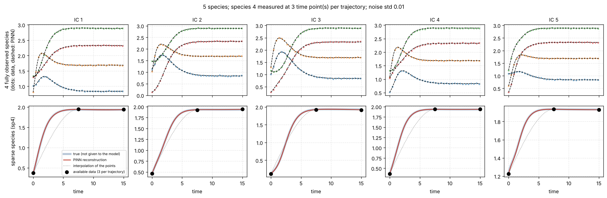
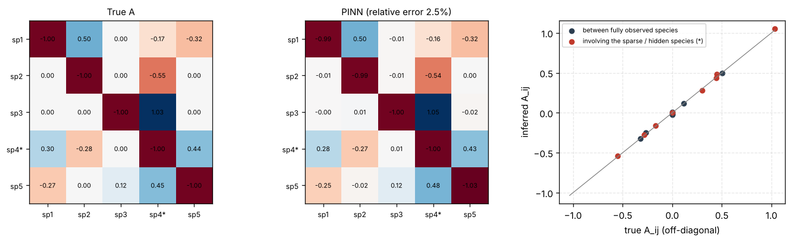
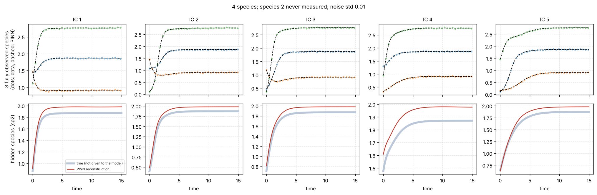

# Inferring the network when one species is barely measured, or not measured at all

Exploration of whether the PINN pipeline of `PINN-Inference.ipynb` can recover the gLV interaction matrix `A` when one
species has only a few data points, or none. All data are simulated with the notebook's generator and integrator.

`Hidden-Species-Demo.ipynb` runs two examples end to end. `summarize.py` prints every number quoted below from the
result files in `results/`.

## Short version

- **One species with a few data points: this works, and regression-based methods cannot do it.**
  With 10 points for that species (the others have 101), the full matrix is recovered almost as well as when everything
  is measured: 2.8% error against 2.4% at noise std 0.01, and 9.9% against 7.7% at 0.03. Without noise this holds
  whichever species is the sparse one. With 1 to 3 points it still works at low noise when the sparse species has a
  strong effect on the others, and is unreliable when its effect is weak.
- **One species with no data at all: only with known growth rates.** With `r` given, the matrix is recovered without
  noise (under 5% error) and at low noise (std 0.01, under 11%), and the hidden species' trajectory is reconstructed
  in 8 of 9 communities. At noise std 0.03 a third of the communities are 35 to 42% off. With nothing known, the
  result cannot be trusted.
- **With a few data points and noise up to std 0.01, the interactions among the fully measured species were within
  8% in every run**, including the runs where the sparse species' own interactions were wrong. Leaving an influential
  species out of the model, as a regression method has to, gives 22 to 99% error on that block.
- The method needed three changes to get there: positive outputs with a log-form residual, an L-BFGS polish after
  Adam, and a masked data loss. Adam alone does not solve the partially observed problem.

## What was tested

- Communities of 3, 4 and 5 species, three random communities per size (the first three generator seeds that stay
  bounded with all species present: 0, 1, 3 / 0, 1, 4 / 0, 13, 18). `2 n` initial conditions, `T = 15`, 101 time points.
- The partially observed species is the **most influential** one (largest `sum_i |A_ih|`) in the main sweeps, and the
  **least influential** one in a separate hard-case sweep.
- Its few data points are evenly spaced and include `t = 0` (1 point means only the initial abundance).
- Noise is additive Gaussian with std 0.01 or 0.03 (the notebook's effective noise std is 0.008).
- Errors are relative Frobenius errors, `|A_est - A_true| / |A_true|`, in %. Tables give the median over the nine
  communities and the range in brackets.
- Baselines are gradient-matching regressions of `d ln x_i / dt` on `[1, x]`: with the sparse species filled in by
  interpolating its points, or with the species left out. Without noise they get the exact derivatives; with noise,
  smoothing splines tuned with the true noise level. Both are favourable to the baseline.

## Results

### 1. One species with a few data points, no noise

Sparse species = most influential one. Error on the full matrix:

| Points for the sparse species | PINN | Interpolate + regress |
|---|---|---|
| 1 (initial abundance only) | 0.2 (0.1-4.8) | 65.4 (57.3-97.3) |
| 3 | 0.1 (0.0-0.3) | 46.5 (25.0-65.4) |
| 5 | 0.1 (0.0-0.2) | 32.6 (9.8-71.5) |
| 10 | 0.1 (0.0-0.2) | 17.5 (3.3-161.0) |

Leaving the species out of the regression gives 31.1 (21.5-98.9) error on the block between the remaining species.

### 2. With noise

Sparse species = most influential one. Error on the full matrix:

| Noise std | PINN, all measured | PINN, 10 points | PINN, 3 points | Regression, all measured | Interpolate + regress, 10 points | Interpolate + regress, 3 points |
|---|---|---|---|---|---|---|
| 0.01 | 2.4 (1.6-4.2) | 2.8 (2.0-4.6) | 3.3 (1.5-12.0) | 8.3 (6.7-9.5) | 16.2 (8.5-151.7) | 46.7 (27.1-65.7) |
| 0.03 | 7.7 (5.2-13.9) | 9.9 (7.0-14.9) | 15.4 (6.3-53.8) | 28.3 (14.7-80.0) | 25.1 (15.6-126.9) | 49.1 (27.4-87.9) |

Example from the demo notebook (5 species, species 4 measured at 3 points, noise std 0.01, 2.5% error on `A`).
The model only sees the black points of the bottom row:





The sparse species' trajectory is reconstructed to 0.4 to 1.5% (median) in all four cases. The weakest part is the
sparse species' own row (how the others affect it): with 3 points at noise 0.03 it was badly wrong in two of nine
communities (30% and 54% error on the full matrix).

### 3. Hard case: the sparse species barely affects the others

Sparse species = least influential one.

| Points | Noise std | PINN, full matrix | Runs under 5% | PINN, block between measured species | Interpolate + regress, full matrix |
|---|---|---|---|---|---|
| 1 | 0 | 37.5 (0.2-62.6) | 4 of 9 | 0.9 (0.1-6.6) | 60.6 (39.4-68.9) |
| 3 | 0 | 1.2 (0.1-26.9) | 5 of 9 | 0.5 (0.0-1.4) | 50.0 (29.9-81.5) |
| 10 | 0 | 0.1 (0.0-1.1) | 9 of 9 | 0.0 (0.0-0.2) | 28.7 (9.8-64.5) |
| 10 | 0.01 | 3.2 (1.9-7.0) | 8 of 9 | 2.4 (1.1-4.5) | 28.5 (11.9-67.0) |

When the species has little effect on the others, its trajectory cannot be read off them, so 1 to 3 points are not
enough to pin down its own interactions. Ten points are.

### 4. One species with no data at all

Hidden species = most influential one. Its abundance scale cannot be identified (multiplying `x_h` by `c` and dividing
its column of `A` by `c` gives the same observations), so `A_hh` is frozen at -1, the generator's value. "Best of
restarts" keeps, for each community, the run that fits the data best (see below). Only runs with more than 10% error
were restarted, twice each.

| Known in advance | Noise std | Single run, full matrix | Best of up to 3 restarts | Runs under 10% (best) | Hidden trajectory (best) |
|---|---|---|---|---|---|
| nothing | 0 | 166.3 (1.3-472.6) | 6.3 (0.2-317.6) | 5 of 9 | 3.1 (0.1-58.4) |
| growth rates `r` | 0 | 0.8 (0.2-214.8) | 0.7 (0.2-4.5) | 9 of 9 | 0.8 (0.1-35.9) |
| growth rates `r` | 0.01 | 7.2 (2.5-181.0) | 7.2 (2.5-10.3) | 8 of 9 | 3.0 (0.6-48.8) |
| growth rates `r` | 0.03 | 12.9 (7.0-272.6) | 12.9 (7.0-42.2) | 4 of 9 | 10.0 (1.8-200.2) |
| `r` and all self-regulation `A_ii` | 0 | 0.2 (0.1-0.9) | not needed | 9 of 9 | 0.1 (0.0-3.4) |

"`r` known" includes the growth rate of the hidden species itself.

Example from the demo notebook (4 species, species 2 never measured, `r` known, noise std 0.01, 4.5% error on `A`):



At noise 0.03 the three worst communities (35 to 42% error) fit the data down to the noise level, so restarts cannot
fix them: at that noise the data no longer determine the answer.

## Telling a good run from a failed one

`metrics['sim_fit_rmse']` integrates the inferred model from the inferred initial state and compares it with the
available data. It uses only the data, so it also applies to real experiments.

- A good run has `sim_fit_rmse` close to the noise level (about 1e-4 without noise).
- Every outright failure (more than 100% error) in the fully hidden sweeps was 1.5 to 5 times above the noise level
  (0.047 to 0.065 against 0.01 to 0.03), and at least 100 times above a good run without noise. With `r` known,
  restarting with another seed fixed the failures without noise and at noise 0.01.
- Runs that are 10 to 20% off are harder to spot: without noise their `sim_fit_rmse` is about 0.001 to 0.003, which
  any realistic noise level would hide.
- `hs.train_with_restarts` does this selection.

## What changed with respect to `PINN-Inference.ipynb`

The curriculum is the notebook's: data-only warm-up, least-squares reset of `(r, A)`, geometric ramp of the physics
weight, refinement with cosine learning-rate decay.

| Change | Why |
|---|---|
| Masked data loss, normalised per species | A species can have few or no data points; its 3 points weigh as much as another species' 101. The physics loss still covers all species. |
| `x = exp(net)` and residual `d ln x/dt - (r + A x)` | With the notebook's residual, `x_h = 0` satisfies the hidden species' equation exactly. |
| L-BFGS polish in double precision after Adam (same loss) | Decisive. On a 3-species test, Adam alone left 8 to 36% error with 1 to 5 points (`exp03`); the cases rerun with the polish came out at about 1% or less. |
| Entries of `r` and `A` can be frozen | Known growth rates, fixed scale of a hidden species. |
| One batched network with analytic time derivatives | Same architecture (3 x 32 tanh per IC), fewer operations per epoch on CPU. |
| Shorter Adam (2000 + 3000 + 1000 epochs), 400 collocation points, no train/validation split, no L1 penalty | Speed; the polish does the fine convergence. |

A run takes 2 to 4 minutes on one CPU core. The results below come from about 190 runs.

## Caveats

- **Baselines are not published tools.** They are my own gradient-matching regressions, which is the family that needs
  every species' time series (it includes the STLSq refinement notebook). Methods that fit ODE trajectories directly
  (shooting, Bayesian ODE fitting, neural ODEs) can also treat a species as unobserved and were not compared.
- Three communities per size, one noise realisation, one network initialisation per run (apart from the restarts).
- The data come from the same model class that is fitted, with `2 n` initial conditions.
- Only evenly spaced points including `t = 0` were tested for the sparse species.
- Relative errors on the sparse species' row are inflated when the true row is close to zero.
- Fixing `A_hh = -1` for a hidden species matches the generator. On real data it means the hidden abundance is in
  arbitrary units and its column of `A` is known up to that scale.
- The STLSq refinement was not run on top of these results.

## Files

| File | Content |
|---|---|
| `hs_pinn.py` | Simulation helpers (copied from the notebook), batched PINN, `train`, `train_with_restarts`, metrics, baselines |
| `Hidden-Species-Demo.ipynb` | Executed demo: 5 species with one measured at 3 points; 4 species with one never measured and `r` known |
| `runner.py` | Runs a list of jobs on 4 processes and appends to a `.jsonl` file |
| `exp06_sparse_sweep.py` | Results 1 |
| `exp08_noise.py` | Results 2 |
| `exp09_least_influential.py` | Results 3 |
| `exp07_fully_hidden.py`, `exp10_hidden_noise_restarts.py`, `exp11_noisy_restarts.py` | Results 4 |
| `exp01` to `exp05` | First trials with earlier settings (Adam only, variable projection, pilot); kept as a record |
| `summarize.py`, `analyze.py` | Tables from the result files |
| `showcase.py` | Plots used in the demo notebook |

```bash
python3 exp06_sparse_sweep.py
```

```bash
python3 summarize.py
```
